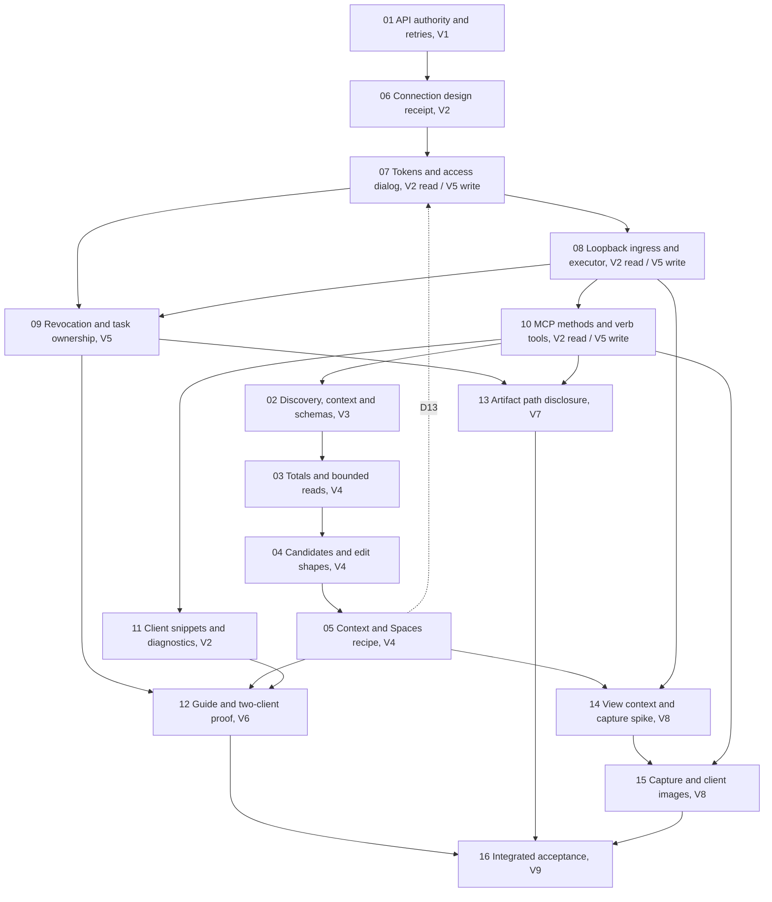

# Phase 3a1 delivery plan

DATE: 2026-10-17
STATUS: Complete 2026-10-18, archived. Every stage merged (#222 to #243); evidence in [STATUS](STATUS.md) and [the stage 16 receipt](evidence/p3a1-16-integrated-acceptance.md).
ISSUE: [#221](https://github.com/bldgtyp/ph-composer/issues/221)

## Delivery sequence

Stages keep their IDs; the Order column is the sequence they are delivered in. Three stages have a
read-scope slice in V2 and a write-scope slice in V5, tracked as two rows of work under one ID.

| Stage | Order | Result | Depends on | Workstream / acceptance |
| --- | --- | --- | --- | --- |
| [P3a1-01](phases/p3a1-01-authority-and-retries.md) | V1 | Own immutable authority values; correct pending retries; review probes promoted | Implementation authorization | W1 / C01 |
| [P3a1-06](phases/p3a1-06-connection-design-and-spikes.md) | V2 | Connection design receipt (transport, port, thread model, executor, budgets) and two host measurements | 01 | W3 / C06 |
| [P3a1-07](phases/p3a1-07-pairing-and-grants.md) | V2 read, V5 write | Token store and the Agent Access dialog; `read` only in V2, the other capabilities and "this Model only" in V5 | 06; write slice in V5 (D06 and D13 consent copy) | W3 / C07 |
| [P3a1-08](phases/p3a1-08-host-executor-and-ingress.md) | V2 read, V5 write | Loopback HTTP ingress, bounded queue, main-thread executor; ingress-assigned sequence (D14) in V5 | 06, 07 (same slice); D12 from 06 | W3 / C08 |
| [P3a1-10](phases/p3a1-10-mcp-companion.md) | V2 read, V5 write | MCP methods and the verb tool surface; read tools in V2, the rest in V5 | 08 (same slice), D09/D13/D14 | W4 / C10 |
| [P3a1-11](phases/p3a1-11-installation-and-diagnostics.md) | V2 | Client snippets at pinned versions, check commands, port and server diagnostics | 07, 08, 10 read slices, D11 | W4 / C11 |
| [P3a1-02](phases/p3a1-02-discovery-and-schemas.md) | V3 | Model-context read (the `context` tool), grant/effect metadata, envelope schemas, shaped by V2's client runs | 01, 10 read slice, D10 | W1 / C02 |
| [P3a1-03](phases/p3a1-03-spaces-totals-and-pages.md) | V4 | Correct aggregates and bounded Space/child/finding reads, budgets set from the clients' output caps | 02, D03/D10 | W2 / C03 |
| [P3a1-04](phases/p3a1-04-space-candidates-and-edit-shapes.md) | V4 | Candidate Face discovery and typed editable values | 03 | W2 / C04 |
| [P3a1-05](phases/p3a1-05-context-and-spaces-recipe.md) | V4 | Guarded Zone/root navigation; public-only Spaces recipe run through the live connection | 02, 04, D04/D13 | W2 / C05 |
| [P3a1-09](phases/p3a1-09-revocation-and-file-scope.md) | V5 | Task ownership and acknowledged revocation | 07 write, 08 write, D06 | W3 / C09 |
| [P3a1-12](phases/p3a1-12-guides-and-two-client-proof.md) | V6 | Shared operating guide as a skill per client; two-client semantic proof | 05, 09, 10 write, 11 | W4 / C12 |
| [P3a1-13](phases/p3a1-13-artifact-handles.md) | V7 | Artifact path and hash disclosure to the producing caller (D07) | 09, 10 write, D07/D12 | W5 / C13 |
| [P3a1-14](phases/p3a1-14-view-context-and-capture-spike.md) | V8 | Semantic camera/selection context; `write_image` spike narrowed to hidden-window and modal behavior (D08) | 05, 08 | W5 / C14 |
| [P3a1-15](phases/p3a1-15-capture-and-client-images.md) | V8 | `ph_composer.view.capture` under the `capture` grant: geometry-only PNG with provenance, overlays declared absent (D08) | 10 write, 14, D08/D12 | W5 / C15 |
| [P3a1-16](phases/p3a1-16-integrated-acceptance.md) | V9 | Integrated receipts, cleanup and handoff | 01 through 15 | Integration / C16 |

Numbers are references to the stage IDs in this table, not evidence that work has started. Dxx
references resolve to [DECISIONS.md](DECISIONS.md). P3a1-01 is the first implementation stage and
waits on nothing but authorization. V2 is the first stage with a real client in the loop and the
first stage Ed can use: its `read` scope exposes neither `invoke` nor any side-effecting `view`,
`setup` or export call, and the grant check at dispatch already enforces that.

Stage 11 had no row in the review's order table because it was an installer; as rewritten it is
the client-side half of the pairing ceremony D3a1-05 describes (the snippet the dialog shows), and
V2's acceptance needs both CLIs configured from it, so it joins V2 as its last piece. Every decision in the register is answered (D3a1-01 to 15, 2026-10-17), so no stage waits on a
product choice; the D3a1-12 starting bounds govern every bounded store and change only with a
recorded measurement.

## Milestones and claims

| Milestone | Gate | Permitted conclusion |
| --- | --- | --- |
| M1 | V1 and V2 | A read-only connection from an installed RBZ, used by the Claude Code CLI and the Codex CLI at recorded versions on the proving host; a pilot for Ed, not a supported-client claim |
| M2 | V3 to V5 | Writes, setup and export through both CLIs; the public-only Spaces workflow run through the live connection; acknowledged revocation |
| M3 | V6 and V7 | The operating guide proved in both CLIs; artifact read-back from disclosed paths; images still pending |
| M4 | V8 and V9 | Complete phase scope accepted or explicitly deferred by Ed with remaining findings visible |

No milestone is public distribution or support for an untested client or platform. A read-only
pilot uses the same token, executor and protocol as the later write scope; it cannot bypass W3
because it is read-only.

## Ownership

| Layer / candidate paths | Owns | Must not acquire |
| --- | --- | --- |
| Existing `shell/api`, dispatch, declarations, registry and session authority | Public contracts, grants, outcomes and scheduling preconditions | Feature-specific Space/Window business branches |
| `features/spaces`, `features/zones` | Summary, child, finding and candidate reads; typed edits; Spaces' own context conveniences; validated authoring | Token, socket or protocol handling; Model-root navigation |
| New foundation modules under `shell/`: `context_commands.rb` (D04) and `capture_command.rb` (D08), with `session/edit_context.rb` | `ph_composer.context.open` and `.root` through `EditContext` with declared lock side effects; `ph_composer.view.capture` under the `capture` grant | Feature knowledge; any path assignment outside `EditContext` |
| New `src/ph_composer/agent_access/` foundation package | The token store and dialog, the loopback listener, queue and pump, the verb table and JSON-RPC methods, sequence assignment, the diagnostics ring, the snippet generator | Record calculations, direct feature dictionaries, `eval`, a second capability authority |
| Existing `runtime/http.rb` | Bounded HTTP reading and writing shared by the asset server and the ingress | Protocol or domain knowledge |
| Existing `export/` | Produced artifact identity, committed bytes and their hashes, task ownership, pre-commit rechecks | Arbitrary filesystem browsing or a new translation path |
| The operating guide, path selected in 12 | Operating recipes and the connection section 11 proves | Provider API keys, development or native-review instructions |

These are proposed ownership boundaries, not a mandate to create one class or file per table cell.
Keep the composition root explicit. Register foundation capabilities once; outside features supply
their own declarations without changing the adapter. Existing [extensibility rules](../../../context/EXTENSIBILITY.md)
remain the design rubric.

## Change coordination and compatibility

Default delivery is one coherent stage or slice and branch at a time after implementation
authorization; V2's four stages may land as one branch per stage in the order 06, 07, 08, 10, 11,
with 07's server hooks no-ops until 08. Later stages may share prerequisites but shared editors must
not overlap on dispatch, registry, session observers, approved locations, the export task, the
composition root or generated docs.

Coordinate with [thermal bridges](../phase-03b-thermal-bridges/PLAN.md) and
[geometry contribution contracts](../geometry-contribution-contracts/PLAN.md) before
touching Zones traversal, generic occurrence reads, declarations or export snapshots. This phase
does not absorb their edge tagging or export work or change their existing requirements.

Audit actual callers before changing public response defaults. Preserve legacy Space trees while
adding bounded automation reads; mark their bounds honestly. Model data and schema migration is not
expected. Any discovered persistence change requires its own round-trip and compatibility design
and decision update. Never update a golden simply to hide a changed contract.

## Verification and stage closure

Use focused checks while editing, then one affected-scope check and coherent-diff review according
to the repository ladder. W3, transport and retry, artifact and native lifecycle changes use the
high assurance profile with a stronger independent reviewer and native checks where specified.
Routine aggregate and schema fixes use the standard profile. Supply existing complexity and coverage
measurements where available; models do not replace those measurements.

Every code stage runs the required `make ci`; exact-head dual-Ruby CI is required before delivery.
The protocol tests (10), the ingress tests (08) and the snippet golden tests (11) enter the normal
gate in their stages, not as optional manual commands; the Ruby 2.7 job is where the hand-written
JSON-RPC surface is proved on the floor. Browser checks cover the access dialog, and native
acceptance remains distinct. Refresh panel and runtime manifests before full gates when shipped
assets change. Required coverage uses the repository thresholds; do not lower them for this phase.

Record a stage, or a slice, as `Implemented on branch` only after its applicable deterministic,
review and native gates have evidence; use an explained N/A for a pure boundary fix that needs no
host check. `Merged` and `client-supported` are separate facts. Record every meaningful phase change
through `docs-pass`. Preserve DCO and hooks. Each stage is one branch, one pull request, one Codex
review and a merge on green CI, under Ed's 2026-10-18 authorization.

Stage 16 screens the final head and reuses unchanged exact-head evidence. It reruns integrated
client and native paths that were not previously proved together, rather than stacking equivalent
reviews or blindly rerunning unchanged suites. Required failed checks remain open.
